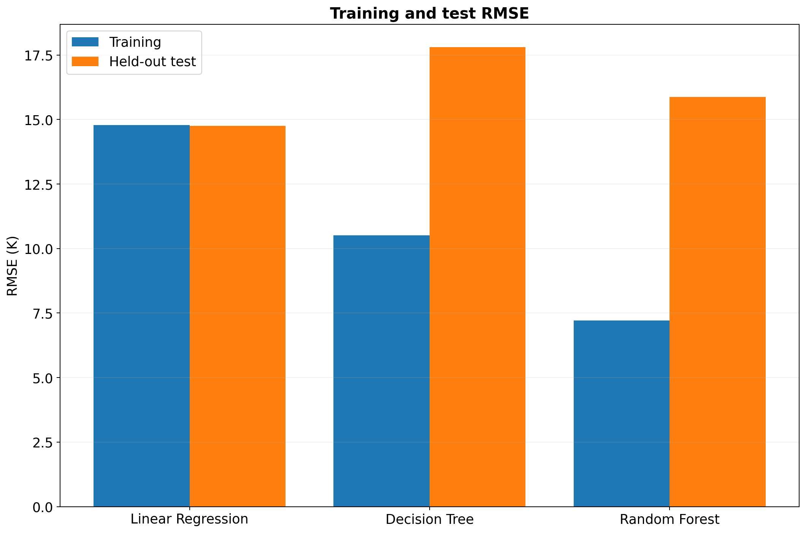
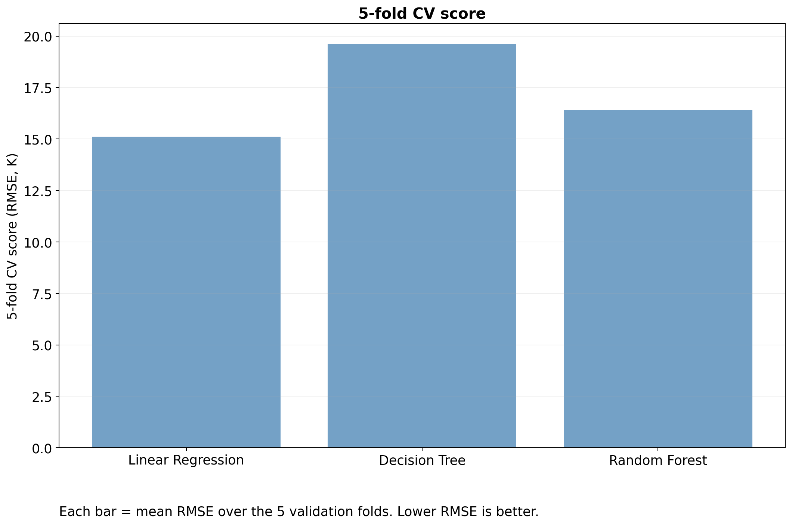
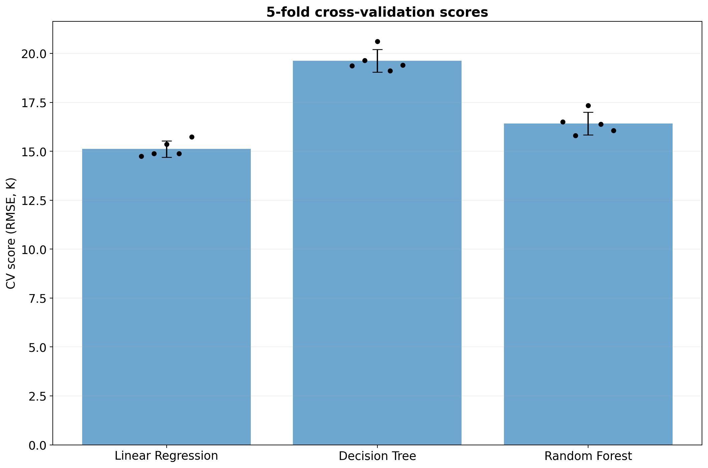
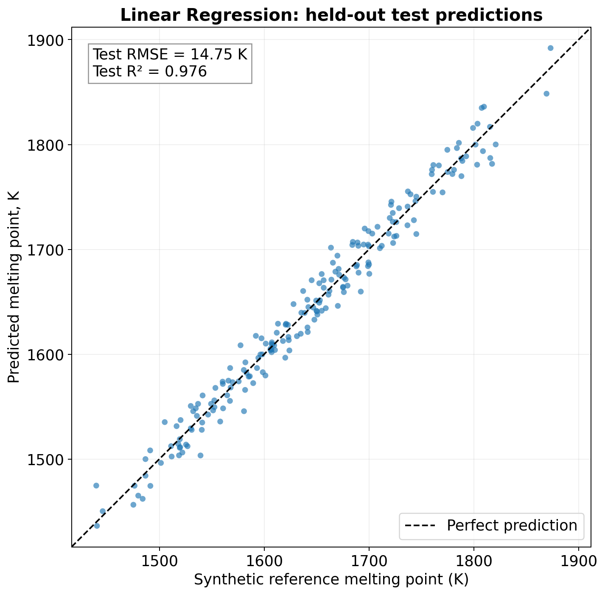
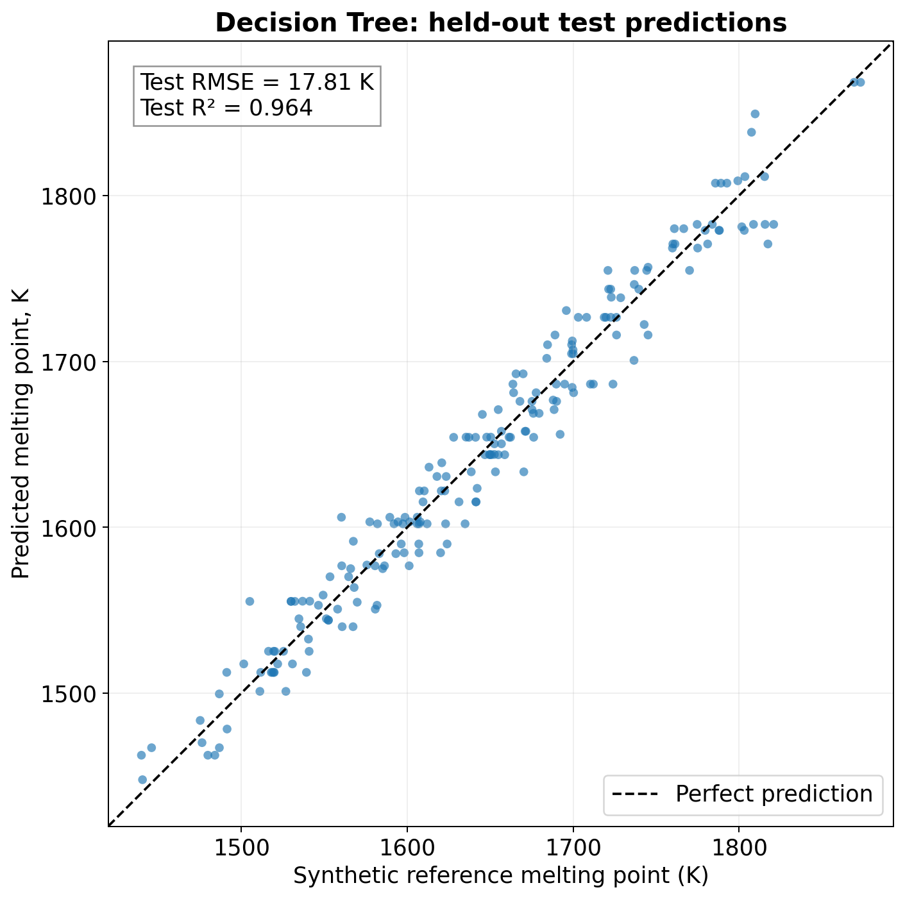
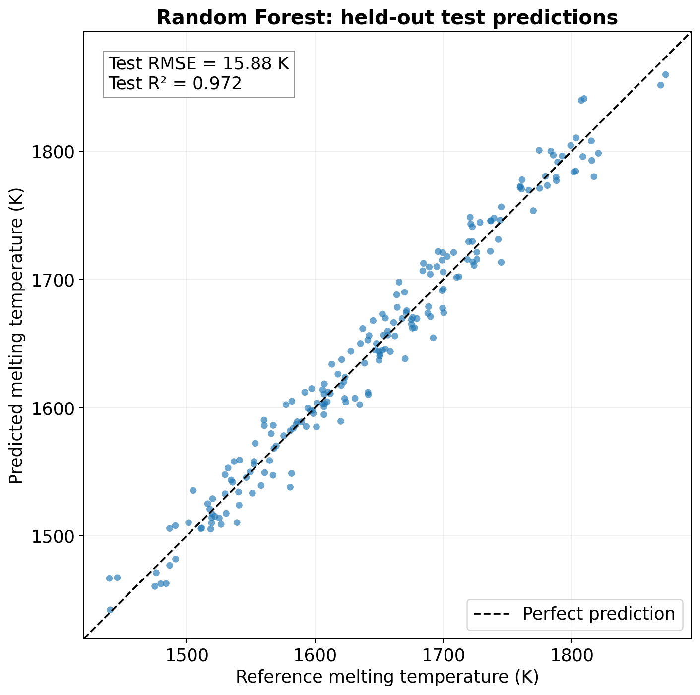
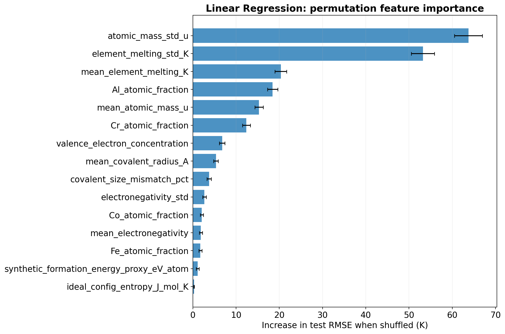
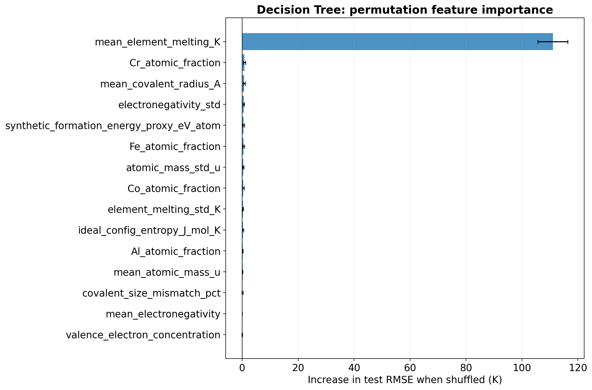
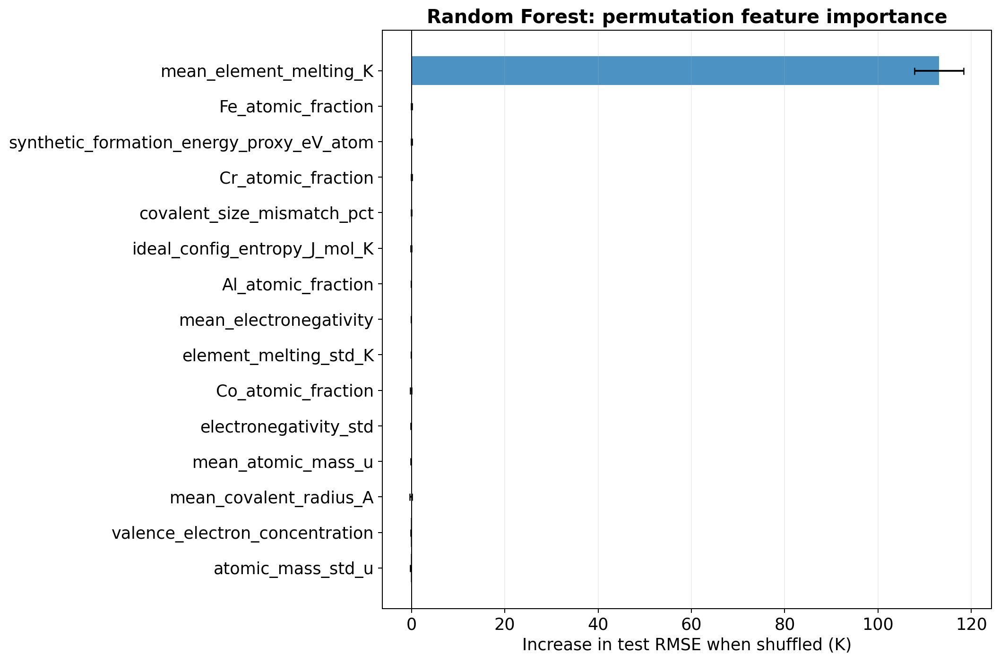

# HEA Melting-Point Prediction with Machine Learning

A Python workflow comparing **linear regression, decision tree regression, and random forest regression** for predicting a synthetic melting-temperature target from Al–Co–Cr–Fe–Ni alloy compositions.

> **Scope:** This is a synthetic-data learning and software demonstration. The dataset contains no experimental, DFT, or CALPHAD melting temperatures. Reported accuracy measures agreement with a synthetic target, rather than validated predictive accuracy for real alloys.

## Contents

- [Data](#data)
- [Descriptors](#descriptors)
- [Installation and execution](#installation-and-execution)
- [Modelling and evaluation](#modelling-and-evaluation)
- [Results and plots](#results-and-plots)
- [Limitations](#limitations)
- [Possible extensions](#possible-extensions)

## Files

| Path | Purpose |
|---|---|
| `HEA_ML_Meltiing_point_predictor.py` | Data validation, descriptor calculation, model training, evaluation, and plotting |
| `AlCoCrFeNi_synthetic_melting_1000.csv` | Dataset containing 1,000 synthetic alloy records |
| `HEA_ML_plots/` | Nine PNG figures generated by the workflow |

The script filename above preserves its current spelling in this repository.

## Data

Each record contains five elemental compositions in **atomic percent** and a synthetic melting-temperature target in **kelvin**.

| Column(s) | Description | Used by the model? |
|---|---|---|
| `composition_id` | Alloy record identifier | No |
| `Al_at_pct`, `Co_at_pct`, `Cr_at_pct`, `Fe_at_pct`, `Ni_at_pct` | Elemental atomic percentages | Used to calculate descriptors |
| `synthetic_melting_point_K` | Synthetic melting-temperature target | Target |
| `synthetic_hardness_HV` | Synthetic hardness | No |
| `synthetic_ultimate_tensile_strength_MPa` | Synthetic tensile strength | No |
| `data_type`, `generation_model`, `mechanical_properties_model` | Dataset provenance labels | No |

The loader checks that required columns exist, composition and target values are finite, every elemental percentage is positive, compositions sum to approximately 100%, and no exact duplicate compositions occur. Fractions are obtained by dividing atomic percentages by 100.

The supplied target spans approximately **1,362–1,884 K**. The CSV identifies its generation model as `toy_mixture_interactions_v1_seed42`; the training script does not regenerate the dataset.

## Descriptors

The script calculates **15 features**, all derived from composition:

| Feature group | Features |
|---|---|
| Composition | Al, Co, Cr, and Fe atomic fractions; Ni is implied by the sum-to-one constraint |
| Composition-weighted means | Atomic mass, covalent radius, elemental melting temperature, electronegativity, and valence electron concentration |
| Composition-weighted spread | Atomic-mass standard deviation, electronegativity standard deviation, and elemental-melting-temperature standard deviation |
| Size mismatch | Covalent-radius mismatch, expressed as a percentage |
| Configurational entropy | Ideal mixing entropy, `−R Σ cᵢ ln(cᵢ)`, in J mol⁻¹ K⁻¹ |
| Illustrative interaction feature | Synthetic formation-energy proxy, `Σᵢ<ⱼ 4cᵢcⱼEᵢⱼ` |

The pair coefficients in the energy proxy are **invented illustrative values**. This feature is not a DFT formation energy, a CALPHAD result, or a measured mixing enthalpy.

The elemental constants are rounded values. The script cites the [Royal Society of Chemistry periodic table](https://periodic-table.rsc.org/) and consistently uses **covalent radii** for its radius descriptors.

## Installation and execution

Clone the repository and enter this folder:

```bash
git clone https://github.com/sharath291994/HEA-ML-models-for-property-predictions.git
cd HEA-ML-models-for-property-predictions/Melting_point_predictor_code
```

Install the dependencies in your Python environment:

```bash
python -m pip install numpy pandas matplotlib scikit-learn
```

Run the script:

```bash
python HEA_ML_Meltiing_point_predictor.py
```

The script locates the CSV relative to its own file, prints the evaluation table, saves nine PNG figures into `HEA_ML_plots/`, and displays the figures using Matplotlib. Existing figures with the same filenames are overwritten.

For a machine without a graphical display, use Matplotlib's `Agg` backend. For example, in a Bash shell:

```bash
MPLBACKEND=Agg python HEA_ML_Meltiing_point_predictor.py
```

The current script saves plots; it does not export fitted models or a metrics CSV. Dependency versions are not pinned, so numerical results may vary slightly between environments.

## Modelling and evaluation

### Workflow

1. Load and validate the dataset.
2. Calculate composition-derived descriptors.
3. Make a reproducible **80% training / 20% held-out test** split: 800 and 200 records, respectively.
4. Evaluate each model using shuffled **five-fold cross-validation on the training set only**.
5. Fit each model on all 800 training records.
6. Calculate training RMSE, held-out test RMSE, and held-out test R².
7. Calculate test-set permutation importance and generate the figures.

The random seed is **42**. Descriptor calculation uses fixed formulas and constants; it does not estimate parameters from the target. For linear regression, `StandardScaler` is inside a pipeline and is fitted separately within each cross-validation training fold.

### Model settings

| Model | Main settings |
|---|---|
| Linear regression | `StandardScaler` followed by `LinearRegression` |
| Decision tree | `max_depth=8`, `min_samples_leaf=5`, `random_state=42` |
| Random forest | `n_estimators=300`, `min_samples_leaf=2`, `max_features=1.0`, `random_state=42`, `n_jobs=-1` |

These are fixed configurations. The script does not perform hyperparameter optimisation.

### Metrics

- **RMSE (K):** square root of the mean squared prediction error. Lower is better; large errors receive greater weight.
- **R²:** performance relative to predicting the evaluation set's mean. A value of 1 indicates perfect predictions; values can be negative.
- **CV mean ± SD:** mean validation RMSE and sample standard deviation across five folds. This spread is not a confidence interval or a per-prediction uncertainty estimate.

## Results and plots

All figures use DejaVu Sans, 16-point bold titles, and 14-point labels, ticks, legends, and annotations on a shared 12 × 8 inch canvas. Figures display at a consistent width of 900 pixels (or the available page width), keeping their text close to README body-text size. Main README sections use level-two headings; figure groups use level-three headings.

The following results were reproduced from the supplied script and CSV:

| Model | Training RMSE (K) | Test RMSE (K) | Test R² | Five-fold CV RMSE, mean ± SD (K) |
|---|---:|---:|---:|---:|
| Linear regression | 14.79 | **14.75** | **0.976** | **15.12 ± 0.42** |
| Decision tree | 10.51 | 17.81 | 0.964 | 19.63 ± 0.58 |
| Random forest | 7.21 | 15.88 | 0.972 | 16.42 ± 0.58 |

**Linear regression gives the lowest cross-validation and held-out test RMSE in this comparison.** The random forest fits the training data more closely, but its lower training error does not produce a lower test error. This ranking applies to the supplied synthetic dataset and the configurations above.

### Figure 1: Training and test errors



The difference between training and test RMSE helps assess how closely each model fits its training data relative to unseen records from the same sampled distribution.

### Figures 2–3: Five-fold cross-validation





Cross-validation uses the same shuffled fold partitions for all three models. Lower validation RMSE is better.

### Figures 4–6: Held-out prediction plots

The reference axis shows synthetic melting temperatures; no CALPHAD calculations are used.

**Linear regression**



**Decision tree**



**Random forest**



Each plot contains the 200 held-out test records. The dashed diagonal represents perfect agreement between predicted and reference temperatures.

### Figures 7–9: Permutation feature importance

The script shuffles each feature on the test set, repeats this **15 times**, and measures the increase in RMSE. A larger positive value indicates greater predictive dependence on that feature under this diagnostic. Error bars show the standard deviation across shuffles.

**Linear regression**



**Decision tree**



**Random forest**



These rankings are model diagnostics, not evidence that a feature physically causes melting-temperature changes. Correlated descriptors complicate interpretation, and independent shuffling can produce feature combinations inconsistent with any alloy composition. Test-set importance should remain a final diagnostic; using it to revise the model would require a fresh independent evaluation.

## Limitations

- **Synthetic target:** High accuracy does not establish predictive performance on experimental alloys. The script states that the weighted elemental melting temperature was used to construct the synthetic target and is also a model input, making the task unusually favourable.
- **One alloy system:** All records contain Al, Co, Cr, Fe, and Ni. Performance on other elements, missing-element compositions, or new alloy families has not been assessed.
- **Random-split evaluation:** The split assesses prediction within the sampled composition distribution. It does not demonstrate extrapolation to withheld composition regions.
- **Redundant descriptors:** Removing Ni avoids one composition dependency, but weighted elemental means remain exact linear combinations of composition fractions and an intercept. Linear-regression coefficients are therefore not uniquely interpretable as physical effects.
- **Illustrative energy proxy:** Its pair coefficients have no independently established physical basis and should be replaced or removed for scientific applications.
- **Scalar melting target:** Real alloys can have distinct solidus and liquidus temperatures. This dataset does not distinguish them.
- **No predictive uncertainty or domain checks:** The workflow does not quantify uncertainty for individual predictions or identify out-of-distribution inputs.

## Possible extensions

1. Use independently sourced experimental or CALPHAD targets, with documented provenance and a clear solidus/liquidus definition.
2. Compare composition-only and descriptor-only feature sets, including a weighted elemental melting-temperature baseline.
3. Add composition-region or alloy-family holdouts to test generalisation.
4. Tune hyperparameters within training-only cross-validation and retain a final untouched test set.
5. Export fitted pipelines, metrics, and predictions; add configurable input/output paths and a prediction interface.
6. Pin dependency versions and add tests for descriptor calculations, invalid inputs, and model save/load behaviour.

## Author

[Sai Sharath Yadavalli](https://github.com/sharath291994)
